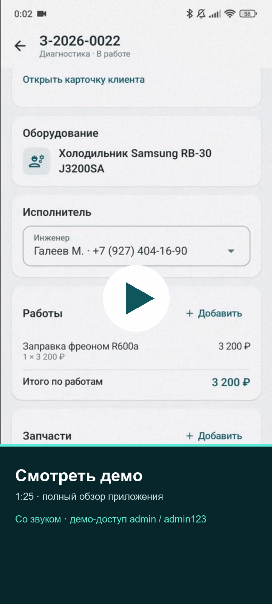
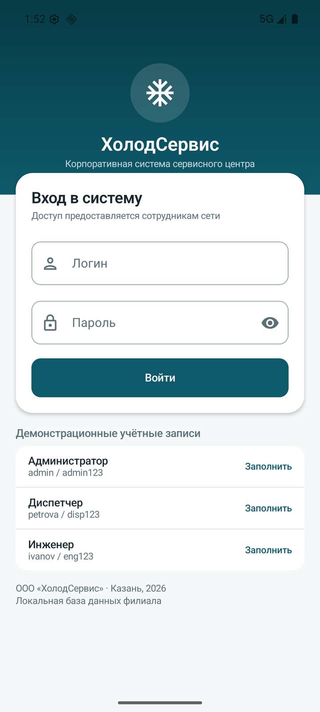
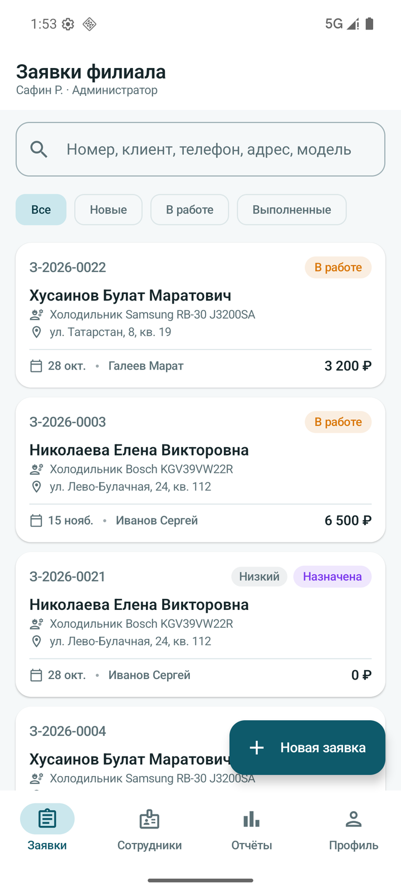
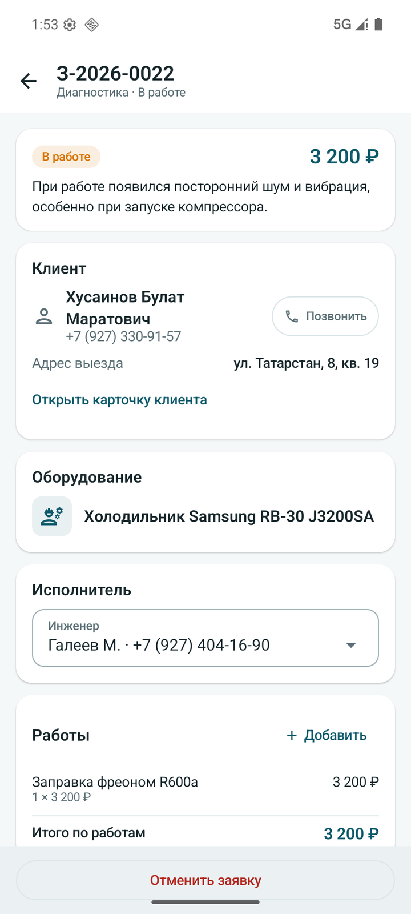
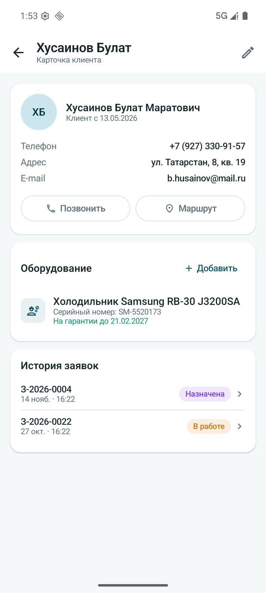
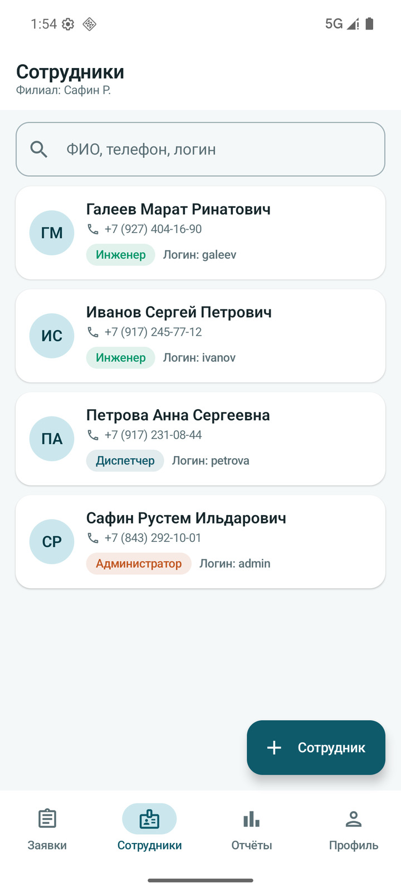
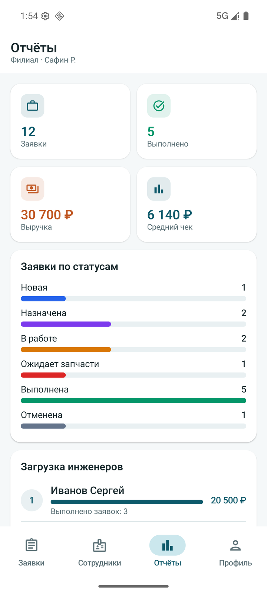

# ХолодСервис

**Мобильное рабочее место сотрудника сети сервисных центров по ремонту холодильного оборудования.** Заявки, клиенты, техника, сотрудники и отчёты — в одном Android-приложении. Работает офлайн на локальной базе Room: без сервера, интернета и регистрации.


**[Скачать APK](apk/HolodService-1.01-debug.apk)** · **[Демо-видео, 1:25](media/demo.mp4)** · **[Скриншоты](docs/screenshots)**

<a href="media/demo.mp4"></a>

## Что это

Приложение для сотрудников сервисного центра: диспетчер принимает заявку, назначает инженера и ведёт её до выполнения, инженер видит свои выезды и фиксирует работы и запчасти, администратор смотрит загрузку филиала и выручку.

Всё хранится локально в Room. При первом запуске база наполняется демонстрационными данными: три филиала, двенадцать сотрудников, восемнадцать клиентов и тридцать шесть заявок — поэтому приложение можно сразу показывать без ручного ввода.

## Демо-доступы

| Роль | Логин | Пароль |
|---|---|---|
| Администратор | `admin` | `admin123` |
| Диспетчер | `petrova` | `disp123` |
| Инженер | `ivanov` | `eng123` |

На экране входа эти учётные записи можно заполнить одним нажатием.

## Возможности

- **Заявки** — создание, поиск по номеру, клиенту, телефону, адресу и модели; фильтр по статусу; назначение инженера; шесть статусов, четыре типа работ, приоритеты; работы и запчасти с расчётом стоимости; отмена с причиной.
- **Клиенты** — карточка клиента, контакты, адрес, оборудование с серийными номерами и гарантией, история заявок.
- **Сотрудники** — список по филиалу, роли, логины и телефоны, добавление и редактирование.
- **Отчёты** — выручка и средний чек, распределение заявок по статусам, загрузка инженеров, структура заявок.
- **Роли** — администратор, диспетчер и инженер видят разные действия; пароли хранятся в виде хеша.
- **Офлайн** — ни одного сетевого запроса и разрешений: вся логика и данные на устройстве.

## Экраны

| Вход | Заявки | Карточка заявки |
|:---:|:---:|:---:|
|  |  |  |
| **Клиент** | **Сотрудники** | **Отчёты** |
|  |  |  |

## Стек

| Слой | Технологии |
|---|---|
| Язык | Kotlin 2.2.10 |
| UI | Jetpack Compose, Material 3, Navigation Compose, Material Icons |
| Архитектура | MVVM, Repository, single-activity |
| Данные | Room 2.8.5 + KSP, SQLite |
| Асинхронность | Kotlin Coroutines, Flow, ViewModel |
| Сборка | Gradle Kotlin DSL, AGP 9.4.1, JDK 17 |
| Платформа | Android 8.0+ (`minSdk 26`), `targetSdk 37` |
| Тесты | JUnit 4 |

## Архитектура

```
app/src/main/java/ru/tisbi/servicecenter/
├── data/                 # Room: сущности, DAO, база, репозиторий, демо-данные
│   ├── Entities.kt       # 9 таблиц и 4 перечисления
│   ├── Daos.kt
│   ├── AppDatabase.kt
│   ├── Repository.kt
│   ├── SeedData.kt
│   └── PasswordHasher.kt
├── ui/
│   ├── screens/          # 11 экранов: вход, заявки, клиенты, сотрудники, отчёты…
│   ├── components/       # общие карточки, чипы, поля
│   ├── theme/            # цвета и типографика
│   ├── AppNav.kt         # навигация и нижние вкладки
│   └── MainViewModel.kt  # состояние экранов и действия
├── MainActivity.kt
└── ServiceCenterApp.kt
```

Схема данных: филиалы → сотрудники и клиенты → оборудование → заявки → работы и запчасти. Роли и статусы заданы перечислениями, связи — внешними ключами Room.

## Сборка

Нужны Android Studio и JDK 17.

```bash
git clone https://github.com/Danon-1ch/HolodService.git
cd HolodService
./gradlew assembleDebug
```

Windows:

```bat
gradlew.bat assembleDebug
```

Готовый APK появится в `app/build/outputs/apk/debug/app-debug.apk`.

## Установка APK

1. Скачайте [`apk/HolodService-1.01-debug.apk`](apk/HolodService-1.01-debug.apk).
2. Разрешите установку из неизвестных источников.
3. Установите приложение и войдите под одной из демо-учётных записей.

APK собран в debug-варианте и подписан отладочным ключом — для публикации в магазине нужен release-ключ.

## Структура репозитория

```
HolodService/
├── app/          # исходный код приложения
├── apk/          # готовый APK отдельным файлом
├── media/        # демонстрационное видео
├── docs/         # скриншоты и превью видео
├── gradle/       # wrapper и каталог версий
└── build.gradle.kts
```

## Данные

Приложение не использует сеть и не требует разрешений. База создаётся при первом запуске и заполняется демо-данными; при очистке данных приложения она создаётся заново. Для реальной эксплуатации потребуется заменить демо-наполнение и настроить резервное копирование.
